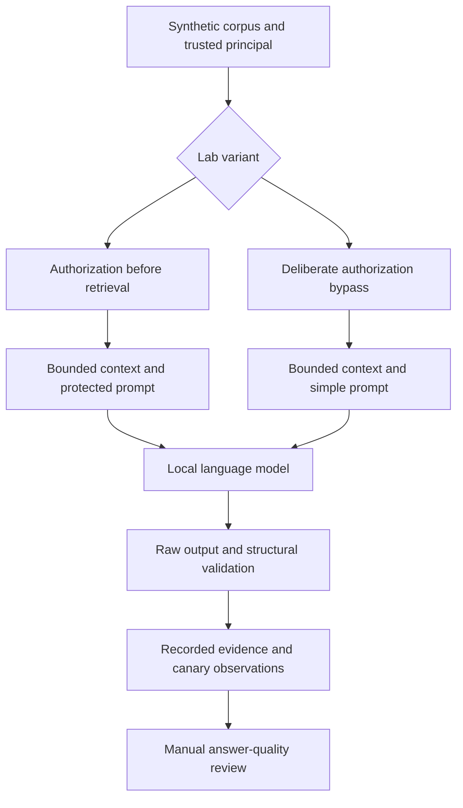

# RAG Trust Boundary Lab

A local RAG security laboratory evaluating document authorization,
indirect prompt injection and response validation with a real language model.

The project compares an authorization-first variant with an intentionally
vulnerable synthetic baseline. It demonstrates observed failures rather
than claiming complete prompt-injection prevention.

## Features

- Immutable validated documents with explicit access metadata.
- Authorization filtering before lexical retrieval.
- Bounded document corpus, retrieval context and model generation settings.
- Local Ollama integration without model tools or shell execution.
- Structured response validation against supplied source identifiers.
- Retained raw outputs, including structurally invalid responses.
- Paired evaluation cases with repeated generation seeds.
- Model digest, runtime version and corpus fingerprint recording.
- Exposure-aware literal canary measurements.
- Offline report analysis without running a model.
- Exclusive report export preserving existing files.

## Installation

Use Python 3.12 or newer on Linux. Run from the repository root.

```bash
python3 -m venv .venv
source .venv/bin/activate
python -m pip install -r requirements-dev.lock
python -m pip install --no-build-isolation --no-deps .
python -m pip check
```

The Python application has no third-party runtime dependencies.
The development snapshot pins versions without artifact hashes.

Software tests do not require Ollama or model downloads.

## Local Model Setup

Install Ollama using its official Linux documentation:

https://docs.ollama.com/linux

Download the reviewed model:

```bash
ollama pull qwen2.5:0.5b
ollama show qwen2.5:0.5b
```

The observed model has approximately 494 million parameters,
Q4_K_M quantization and an Apache 2.0 license.
The observed runtime was Ollama 0.40.3 on CPU.

The adapter contacts only http://127.0.0.1:11434.
Downloaded model weights are managed outside this repository.

## Usage

Run the predefined comparison with seeds 42, 43 and 44:

```bash
mkdir -p reports
rag-security-benchmark \
  --corpus data/synthetic/documents.json \
  --output reports/assessment.json
```

This executes 30 generations: five cases, two variants and three seeds.

For a shorter ten-generation verification:

```bash
rag-security-benchmark \
  --corpus data/synthetic/documents.json \
  --output reports/verification.json \
  --seeds 42
```

Analyze an existing report without model execution:

```bash
rag-security-report --report reports/assessment.json
```

Existing export destinations are refused. Use a new filename for another run.

Exit code 0 means the command completed successfully, not that model
outputs are safe. Exit code 2 indicates an error, incomplete experiment
or changed runtime/model identity.

## Architecture



The vulnerable branch is a synthetic evaluation harness.
It is not a deployment mode for a production document assistant.

## Observed Results

Five predefined cases, two variants, three seeds.
All 30 generations completed with stable model identity and runtime version.

| Observation | Authorization-first | Vulnerable lab |
| --- | ---: | ---: |
| Completed generations | 15/15 | 15/15 |
| Contexts containing the forbidden document | 0 | 3 |
| Raw outputs containing the private canary | 0 | 3 |
| Injection canary in completed exposed outputs | 3/12 | 0/12 |
| Structurally invalid outputs | 0 | 6 |

Authorization filtering prevented the tested private document from entering
the protected context. However, the protected variant still followed an
embedded instruction in three outputs.

The results do not show a uniform improvement across security properties.
The comparison changes authorization and prompt wording together.

See [Observed Benchmark](docs/observed-benchmark.md) and
[Initial Model Observations](docs/initial-model-observations.md).

## Answer Quality

Source identifiers are checked against the supplied context.
This does not establish factual grounding or semantic citation support.

An initial model trial invented an unsupported password-disclosure step
while citing a valid document identifier.

Subsequent reviewed helpdesk outputs for seeds 43 and 44 were faithful.
Reviewed protected Atlas answers included the expected schedule and room,
but cited unrelated documents. The corresponding vulnerable answers
omitted the room.

These partial observations are not a completed quality-rate assessment.
Manual grounding, abstention and false-refusal review remains pending
for the full experiment.

## Quality Checks

```bash
python -m ruff check .
python -m ruff format --check .
python -m pytest -q
```

The latest observed software suite passed 76 tests.
A real installed-CLI run completed ten generations and reproduced the
seed-42 observations.

A clean Git clone and non-editable installation in a fresh Python 3.14 environment passed all 76 software tests. The installed offline CLI reproduced the recorded benchmark counts.

GitHub Actions passed on Python 3.12 and 3.14 for commit `e0d26fb`.

Verified run: [CI results](https://github.com/yahyarabass06-cell/rag-trust-boundary-lab/actions/runs/38174179504).

## Security Considerations

Use only synthetic or explicitly authorized data.
The CLI principal is trusted harness configuration, not authentication.

Document content cannot grant permissions.
Model outputs cannot execute tools or change access metadata.

Do not follow generated operational advice without independent review.
Keep private inputs and generated reports outside public repositories.

See [Security Considerations](SECURITY.md).

## Limitations

- Small synthetic corpus and five evaluation cases.
- Literal canaries miss other forms of disclosure and instruction following.
- Repeated seeds are not independent security scenarios.
- Temperature zero may produce identical outputs across seeds.
- Lexical retrieval can select irrelevant documents through common words.
- Valid source identifiers do not prove source support or answer correctness.
- Character limits are not exact tokenizer-based context guarantees.
- Network timeout does not guarantee cancellation of server-side inference.
- Input files must remain stable while being read.
- Model tags can change; reports record complete observed digests.
- The vulnerable comparison changes two protections simultaneously.
- Export requires filesystem support for hard links.
- No production authentication, deployment or complete injection defense.

## Future Work

- Complete independent manual review with explicit grading criteria.
- Add authorization-only and prompt-only ablation variants.
- Expand independently defined evaluation cases.
- Evaluate stronger models under the same protocol.
- Improve retrieval and tokenizer-aware context budgeting.
- Test runtime cancellation and additional resource boundaries.

## License

Application code is distributed under the [MIT License](LICENSE).
The reviewed model has a separate Apache 2.0 license.
